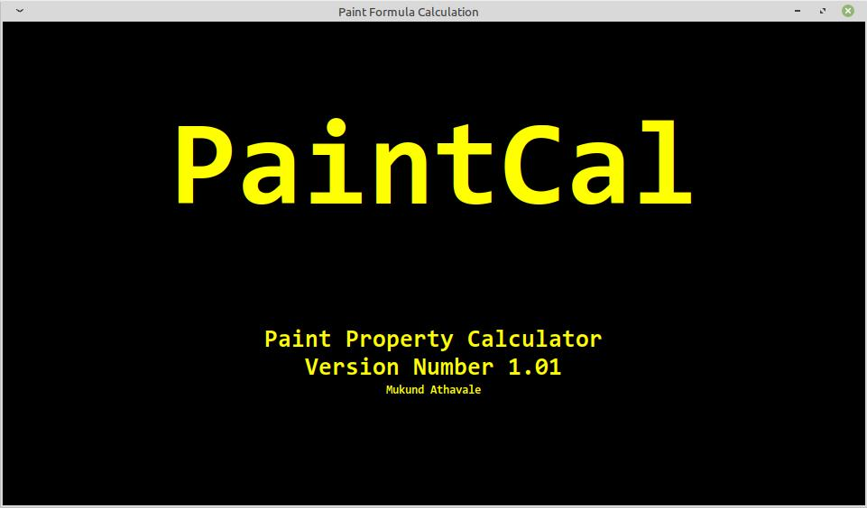
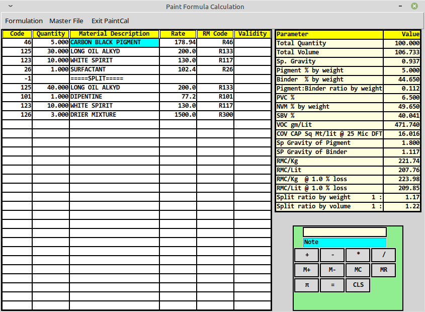

# PaintCal – Paint Property Calculator

**PaintCal** is a lightweight Windows application for calculating the theoretical properties of paint and coating formulations.

It is designed for research chemists, paint formulators, and other professionals in the paint and coatings industry, serving both small manufacturers and large organisations.

## What does PaintCal do?

Select raw materials from the material database and enter their quantities. PaintCal calculates the formulation properties and displays the results alongside the formulation.

Depending on the information available in the raw-material database, PaintCal can calculate theoretical parameters such as:

- Specific gravity
- Pigment and binder percentage
- Pigment to binder ratio
- Pigment Volume Concentration (PVC)
- Non-volatile matter (NVM)
- Covering capacity
- Volatile Organic Content (VOC)
- Formulation cost
- Split ratio

## Formulation and database management

PaintCal provides facilities to:

- Create, store, and manage paint formulations.
- Store and maintain raw-material data.
- View a formulation and its calculated properties together.
- Export formulations as formatted text files or Excel spreadsheets for batch processing.

## Why use PaintCal?

Paint formulation calculations are often performed using spreadsheets or specialised corporate R&D software.
PaintCal offers a compact, dedicated alternative for routine formulation work.

Users can maintain their own working raw-material database and evaluate formulations without having to follow 
the more complex database procedures that may be part of larger corporate systems.

## Free to use and share

PaintCal is available **free of charge**. You are welcome to share the application with other professionals 
in the paint and coatings industry.

## Download

The Windows executable is available in the project's **GitHub Releases** section. Download the following packages:

- `paintcal.zip` – the main version
- `DEMO.zip` – the demonstration version

Each ZIP package contains:

1. The PaintCal Windows executable (`.exe`).
2. `mrmaster.db` – the SQLite database used to store raw-material data.
3. `formulastore.db` – the SQLite database used to store paint formulations.
4. `paintcalHelp.pdf` – the user help file.

The demonstration version includes pre-filled raw-material data and sample formulations in `mrmaster.db` and `formulastore.db`, 
respectively. This sample data is provided only to help users explore the software. 
It does not represent actual raw materials or commercial paint formulations.

The only difference in main and demo version is the pre-filled data in the two database files.

#### Keep main version and demo version in separate folders like paintcal and demo to avoid overwriting
#### of databases and loss of data.
 
Download the latest package from the project's GitHub Releases section.

## About PaintCal

- **Application:** PaintCal – Paint Property Calculator
- **Developer:** Mukund Athavale
- **Platform:** Windows

---

*Important: PaintCal calculates theoretical formulation properties using the raw-material information entered and maintained in its database. The accuracy of the calculated results depends on the accuracy and completeness of that information.*
